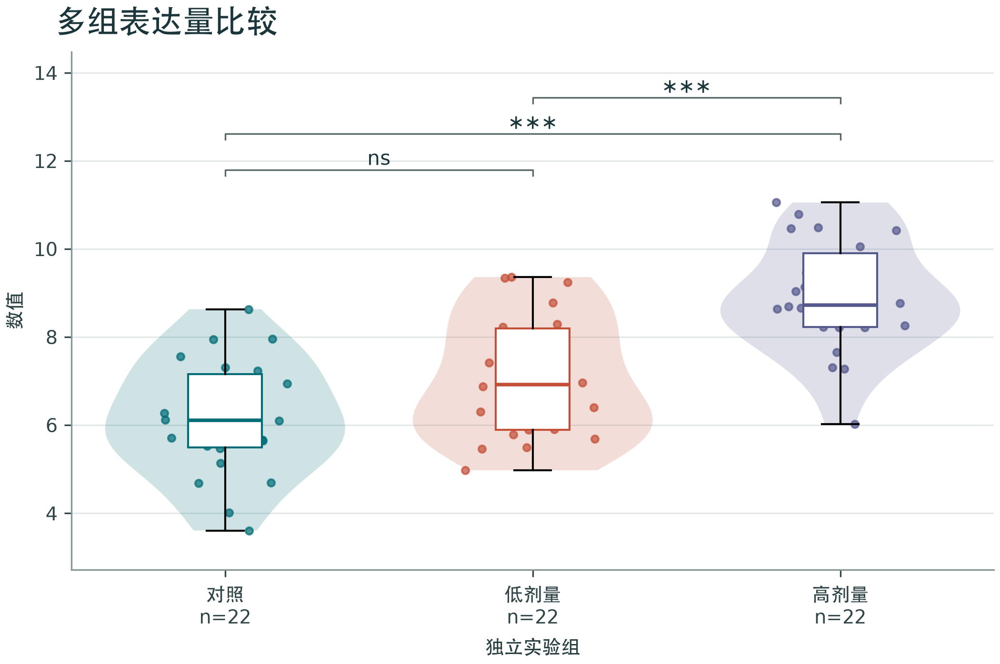
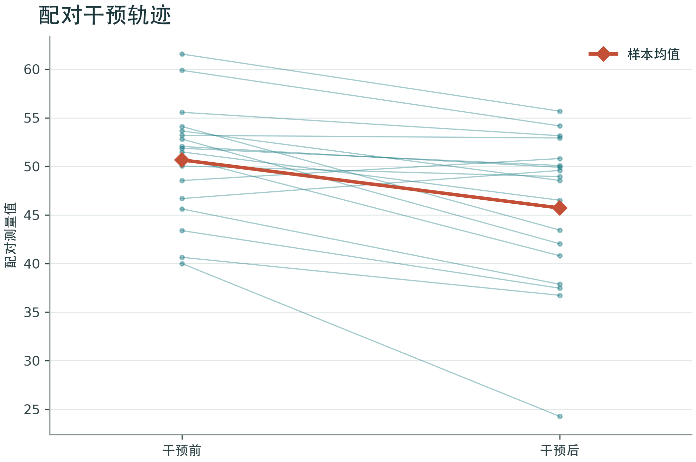
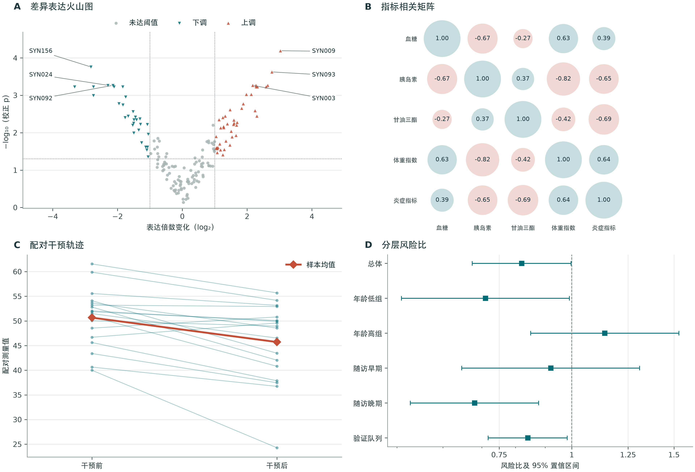

# QingYan SciPlot Lite · 清研科研绘图与自动统计检验工具（开源体验版）

> **作者主页与完整版支持**：本项目由「清研数据工具」原创开发与持续维护，已在爱发电正式入驻：  
> **https://ifdian.net/a/qingyandata**

本仓库提供 **QingYan SciPlot** 系列的开源轻量体验脚本与 300 DPI 示例成图，帮助本科毕设、硕博组会与论文作者在不上传任何原始实验数据的前提下，在本地电脑快速完成规范统计检验与出版级图表绘制。

---

## 为什么做这套离线工具？

科研作图最常见的两个痛点：
1. **统计方法用错被审稿人打回**：不做正态性与方差齐性预检就盲目跑常规 t 检验 / ANOVA，或多重比较漏做校正；
2. **默认绘图不满足投稿规范**：分辨率不足 300 DPI、矢量图嵌入位图、配色对色盲读者不友好、图例遮挡散点。

---

## 示例成图展示（全部由本工具基于合成数据离线生成，300 DPI）

### 1. 分组比较箱线散点图（自动显著性检验）


### 2. 配对前后连线对比图


### 3. 多面板复合排版示例（完整版功能展示）


---

## 快速体验（3 分钟本地离线跑通）

```bash
pip install -r requirements.txt
python3 src/quick_boxplot.py --input demo_data/comparison.csv --out output/demo_box
```

运行后将在 `output/` 目录生成：
- `demo_box.png`（300 DPI 投稿级位图）
- `demo_box.svg`（可直接在 Illustrator / Inkscape 编辑的纯矢量图）
- 终端自动输出正态性检验（Shapiro-Wilk）、方差齐性检验（Levene）与对应假设检验统计量及精确 `p` 值。

---

## 开源体验版 vs 完整版对照

| 能力模块 | 开源体验版（本仓库） | 完整版（爱发电支持） |
| --- | :---: | :---: |
| 分组箱线散点图 + 基础自动统计检验 | ✅ | ✅ |
| 显著性星号连线 + Tukey / Dunn-BH 事后两两比较 | 基础输出 | ✅ 全自动标注 |
| 中英文论文 Methods 统计描述自动生成 | — | ✅ |
| 12 类顶刊图型（KM 生存曲线 / ROC+DeLong / 火山图 / 聚类热图 / PCA / 森林图 / 相关性矩阵 / 轨迹图 / 多面板拼图） | 仅演示样图 | ✅ 全部引擎与样表 |
| 本地浏览器离线画廊与 Excel 直接导入 | — | ✅ |

获取精选版（¥9.9）或 12 类 SCI 科研图完整版（¥39.9）及持续版本更新，欢迎前往我的爱发电创作者主页支持：  
👉 **https://ifdian.net/a/qingyandata**

## License

MIT License（本开源体验版脚本与合成示例数据采用 MIT 协议开源）。
