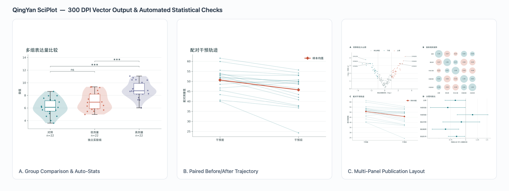

<div align="center">

# QingYan SciPlot Lite

Local-first Python utility for publication-ready grouped plots and automated statistical testing.


[Quick Start](#quick-start) · [Decision Logic](#statistical-decision-logic) · [Editions](#lite-vs-full) · [Sponsor (Afdian)](https://ifdian.net/a/qingyandata)

</div>

<p align="center">
  
</p>

## Overview

`QingYan SciPlot Lite` runs completely offline on local CSV/Excel datasets. Before plotting, it automatically checks normality and homogeneity of variance, selects the corresponding parametric or non-parametric test, and exports 300 DPI raster (`PNG`) alongside editable vector (`SVG`) figures with CJK font fallback.

All sample outputs in `examples/` are generated offline from synthetic datasets (`demo_data/`).

## Quick Start

```bash
pip install -r requirements.txt
python3 src/quick_boxplot.py --input demo_data/comparison.csv --out output/demo_box
```

Example terminal output on `demo_data/comparison.csv`:

```text
[OK] method=One-way ANOVA | normal=True | equal_var=True | stat=24.0257 | p=1.75886e-08
[OK] saved: output/demo_box.png & output/demo_box.svg
```

### CLI Options

| Flag | Default | Description |
| :--- | :--- | :--- |
| `--input` | `demo_data/comparison.csv` | Input CSV path (long format) |
| `--group-col` | `group` | Grouping column name (falls back to column 0) |
| `--value-col` | `value` | Numeric value column name (falls back to column 1) |
| `--out` | `output/comparison_lite` | Output file path prefix (writes `.png` and `.svg`) |

## Statistical Decision Logic

1. **Pre-checks**: Runs Shapiro–Wilk normality test per group (`alpha = 0.05`) and Levene's test for equal variances (`alpha = 0.05`).
2. **Two groups**: Independent *t*-test (normal + equal variance), Welch's *t*-test (normal + unequal variance), or Mann–Whitney *U* test (non-normal).
3. **Three or more groups**: One-way ANOVA (normal + equal variance) or Kruskal–Wallis *H* test (otherwise).

## Lite vs. Full

| Feature | Lite (This Repo, MIT) | Full Suite |
| :--- | :---: | :---: |
| Grouped box + jitter scatter (`PNG` 300 DPI / `SVG`) | Included | Included |
| Automated Shapiro–Wilk + Levene + primary omnibus test | Included | Included |
| Automated post-hoc brackets (`Tukey HSD` / `Dunn + BH`) | — | Included |
| Bilingual `Methods` statistical summary export | — | Included |
| 12 figure engines (KM survival, ROC + DeLong, volcano, heatmap, PCA, forest, paired, trajectory, correlation, multi-panel) | Sample PNGs only | Included |
| Offline interactive gallery & Excel template support | — | Included |

## Support & Updates

Maintained by **清研数据工具**. Full suite releases and ongoing development are hosted on Afdian: [https://ifdian.net/a/qingyandata](https://ifdian.net/a/qingyandata)

## License

MIT
